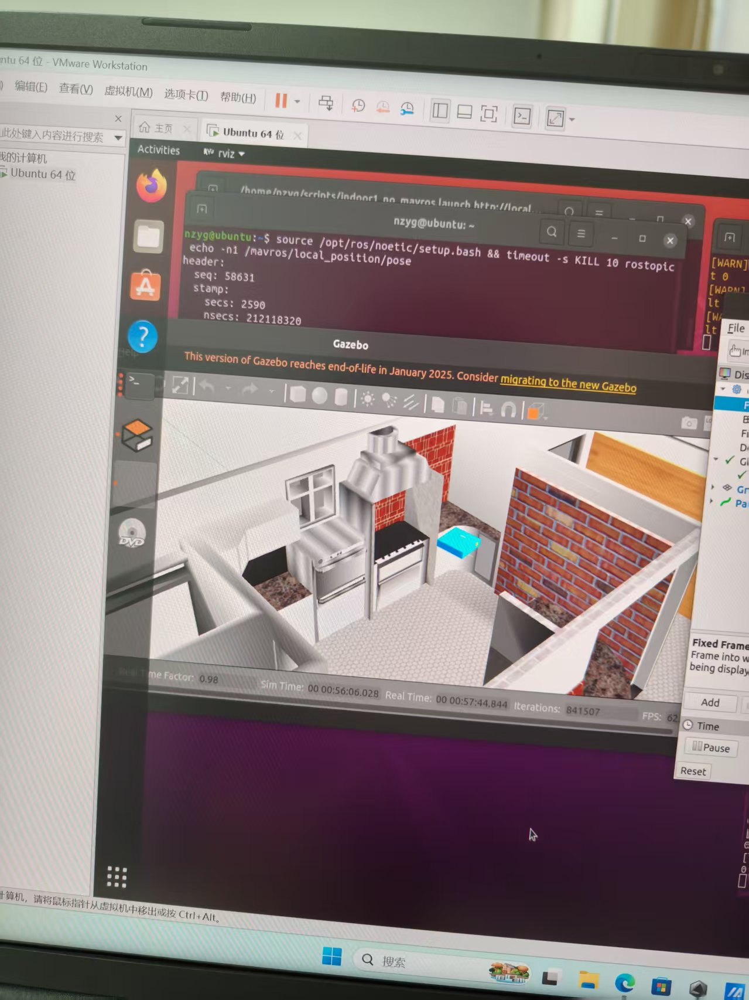
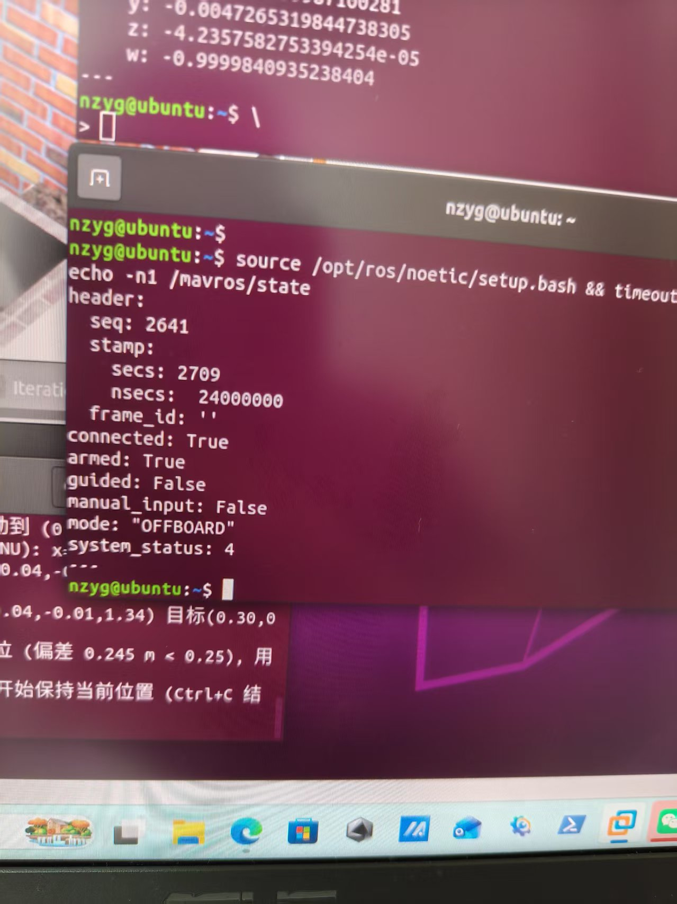
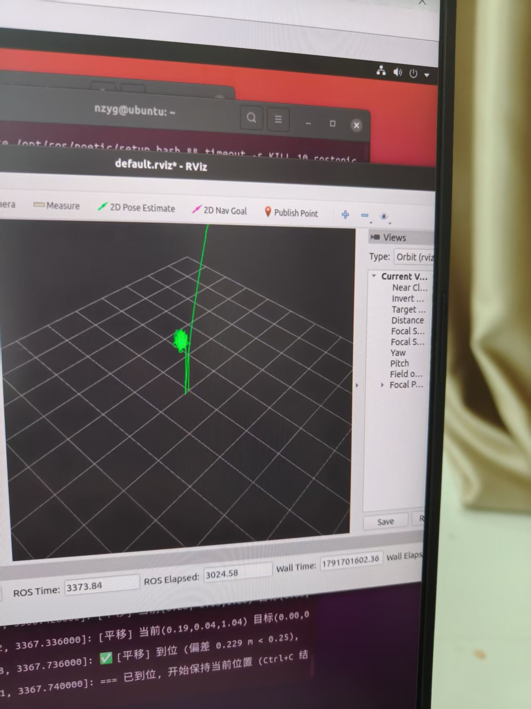
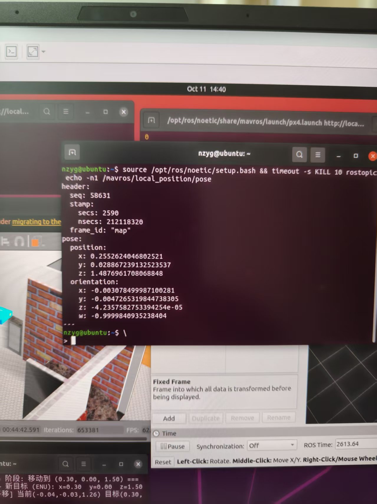

# YESLab — Gazebo + VINS-Fusion + PX4 室内视觉惯性定位与位置控制

> 在 VMware Ubuntu 20.04（ROS Noetic + Gazebo Classic 11）里，用**真实物理运动**跑通
> `Gazebo → 双目/IMU → VINS-Fusion → MAVROS → PX4 EKF2 → OFFBOARD 位置控制` 全链路。
> 相机**刚性安装在机体上**，VIO 的视差来自机体真实飞行，**不使用任何 ground-truth 注入或脚本伪造位姿**。

[](video/demo_link.txt)
[](images/02_mavros_state_offboard_armed.jpg)
[](images/01_gazebo_cafe_rtf0.98_fps62.jpg)
[](#)
[](#)

---

## 一、实验环境

| 项 | 版本 / 路径 |
|---|---|
| 操作系统 | Ubuntu 20.04.6 LTS，kernel 5.15.0-139 |
| 虚拟化 | VMware Workstation（显卡 VMware SVGA II，3D 加速 `SVGA3D`） |
| ROS | Noetic（`/opt/ros/noetic`） |
| Gazebo | Classic **11.15.1**（`gzserver` + `gzclient`） |
| PX4 | **v1.13.3**（`~/PX4-Autopilot`，SITL target `px4_sitl_default`） |
| VINS-Fusion | `~/catkin_ws/src/VINS-Fusion`（`vins_node`，双目 + IMU） |
| mavros | `ros-noetic-mavros 1.20.1` / `gazebo-ros 2.9.3` |
| 机型 | `iris` + `iris_stereo_camera`（双目 752×480@10Hz + IMU 200Hz，刚性 joint 挂 `base_link`） |
| 世界 | `indoor1.world`（XTDrone cafe 场景，含 `cafe / bookshelf / cabinet` 等 13 个模型） |

### 必要的环境变量（已写入 `~/.bashrc` 的 `PX4 SITL ENV` 块）

```bash
export PX4=$HOME/PX4-Autopilot
export ROS_PACKAGE_PATH="$PX4:$PX4/Tools/sitl_gazebo:$ROS_PACKAGE_PATH"   # 必须含 $PX4 本身
source "$PX4/Tools/setup_gazebo.bash" "$PX4" "$PX4/build/px4_sitl_default"
export GAZEBO_MODEL_PATH="$PX4/Tools/sitl_gazebo/models:/usr/share/gazebo-11/models"
export GAZEBO_PLUGIN_PATH="/opt/ros/noetic/lib:/usr/lib/x86_64-linux-gnu/gazebo-11/plugins"
export LD_LIBRARY_PATH="$PX4/build/px4_sitl_default/build_gazebo:$LD_LIBRARY_PATH"
```

> ⚠️ `setup_gazebo.bash` **只设 GAZEBO_\*/LD_LIBRARY_PATH，不设 ROS_PACKAGE_PATH**；
> 少了 `$PX4` 本身会报 `RLException: ... neither a launch file in package [px4]`。
>
> ⚠️ `roslaunch px4 indoor1.launch` 时 **gzserver 必须有可用的 X display**，否则
> `Rendering is disabled` → 所有 `CameraSensor` 创建失败 → 相机永远 0 帧。

---

## 二、数据流链路

```
                        ┌─────────────── Gazebo Classic 11 ────────────────┐
                        │ gzserver: indoor1.world + iris_stereo_camera     │
                        │   ├─ stereo_camera (左/右 type="camera" + imu)   │
                        │   │    libgazebo_ros_camera.so / _imu_sensor.so  │
                        │   ├─ model://gps  (libgazebo_gps_plugin.so)      │
                        │   └─ motor_model / magnetometer / barometer /    │
                        │      mavlink_interface   (HIL, TCP 4560)         │
                        └──────────────────────────────────────────────────┘
                              │                        ▲
        ROS 图像/IMU 话题      │                        │ HIL_SENSOR / HIL_GPS
                              ▼                        │
        ┌──────────────────────────────────────────┐  │
        │ VINS-Fusion (vins_node, /vins_estimator) │  │
        │  双目跟踪 + IMU 预积分 + 紧耦合优化        │  │
        │  → /vins_estimator/odometry (ENU/FLU)    │  │
        └──────────────────────────────────────────┘  │
                              │                        │
                              ▼                        │
        ┌──────────────────────────────────────────┐  │
        │ vins_to_px4.py  (坐标桥接)                │  │
        │  p_ned = M·p_enu , M=[[0,1,0],[1,0,0],[0,0,-1]]
        │  R_ned_frd = M·R_enu_flu·A , A=diag(1,-1,-1)
        │  → /mavros/vision_pose/pose (stamp 取 VINS)
        └──────────────────────────────────────────┘  │
                              │                        │
                              ▼                        │
        ┌──────────────────────────────────────────┐  │
        │ mavros  fcu_url=udp://:14540@127.0.0.1:14580
        │  话题 /mavros/...  服务 set_mode / arming │  │
        └──────────────────────────────────────────┘  │
                              │  MAVLink                │
                              ▼                        │
        ┌──────────────────────────────────────────┐  │
        │ PX4 SITL (bin/px4 -i 0 -w sitl_iris_0)    │  │
        │  EKF2: IMU/baro/mag/GPS + vision_pose     │  │
        │  以稳定的 20Hz setpoint 流为前提切 OFFBOARD│  │
        └──────────────────────────────────────────┘  │
                                                       │
  位置控制: move_drone.py ──20Hz──▶ /mavros/setpoint_position/local ──▶ OFFBOARD
```

**关键点**：`move_drone.py` 以 **20 Hz** 持续向 `/mavros/setpoint_position/local` 发送
`geometry_msgs/PoseStamped`（ENU），构成位置闭环；PX4 收到稳定 setpoint 流后才接受 OFFBOARD。
setpoint 断流超过 `COM_OF_LOSS_T`（本机 1.0 s）时 PX4 会退出 OFFBOARD。

---

## 三、实际话题表（实测）

### 3.1 Gazebo → VINS（相机 / IMU）

| 话题 | 类型 | 频率（实测） | 发布者 |
|---|---|---|---|
| `/iris_0/stereo_camera/left/image_raw` | `sensor_msgs/Image` | **9.11 Hz** | `/gazebo` |
| `/iris_0/stereo_camera/right/image_raw` | `sensor_msgs/Image` | **9.11 Hz** | `/gazebo` |
| `/iris_0/stereo_camera/left/camera_info` | `sensor_msgs/CameraInfo` | 9.11 Hz | `/gazebo` |
| `/iris_0/stereo_camera/right/camera_info` | `sensor_msgs/CameraInfo` | 9.11 Hz | `/gazebo` |
| `/iris_0/imu_gazebo` | `sensor_msgs/Imu` | **341 Hz** | `/gazebo` |

> 频率在真实桌面 X（GPU `SVGA3D`）+ `gui:=false` 下用 rospy 直接计数得到，**RTF = 0.996**。
> 图像规格：`752×480`、`encoding=rgb8`、`frame_id=stereo_camera_left_frame`，
> `header.stamp` 为 Gazebo 仿真时间（**非 0**）。

### 3.2 VINS 输出（节点 `/vins_estimator`，`NodeHandle("~")` → 私有命名空间）

| 话题 | 类型 | 说明 |
|---|---|---|
| `/vins_estimator/odometry` | `nav_msgs/Odometry` | **主输出**，供桥接消费 |
| `/vins_estimator/camera_pose` | `nav_msgs/Odometry` | 相机位姿 |
| `/vins_estimator/imu_propagate` | `nav_msgs/Odometry` | IMU 递推 |
| `/vins_estimator/path` | `nav_msgs/Path` | 轨迹（RViz） |
| `/vins_estimator/point_cloud` | `sensor_msgs/PointCloud` | 稀疏点云 |
| `/vins_estimator/image_track` | `sensor_msgs/Image` | 特征跟踪图（需 `show_track: 1`） |

### 3.3 桥接 → PX4

| 话题 | 类型 | 方向 |
|---|---|---|
| `/mavros/vision_pose/pose` | `geometry_msgs/PoseStamped` | 桥接 **发布** → mavros 转发 EKF2 |
| `/mavros/setpoint_position/local` | `geometry_msgs/PoseStamped` | `move_drone.py` **发布**（20 Hz） |

### 3.4 mavros 状态与反馈（实测均有数据）

| 话题 | 类型 | 备注 |
|---|---|---|
| `/mavros/state` | `mavros_msgs/State` | `connected: True`，含 `mode` / `armed` |
| `/mavros/home_position/home` | `mavros_msgs/HomePosition` | ✅ 有数据（PX4 `home set` 之后） |
| `/mavros/local_position/pose` | `geometry_msgs/PoseStamped` | ✅ **约 30 Hz**（`frame_id="map"`，ENU） |
| `/mavros/local_position/velocity_local` | `geometry_msgs/TwistStamped` | ✅ |
| `/mavros/global_position/local` | `nav_msgs/Odometry` | ✅ |
| `/mavros/imu/data_raw` | `sensor_msgs/Imu` | ✅ |
| `/mavros/altitude` | `mavros_msgs/Altitude` | ✅ |
| `/mavros/battery` | `sensor_msgs/BatteryState` | ✅ |
| `/mavros/estimator_status` | `mavros_msgs/EstimatorStatus` | ✅ |
| `/mavros/extended_state` | `mavros_msgs/ExtendedState` | ✅ |

> ⚠️ **不要裸跑 `rostopic echo`**：本机上它在僵尸节点堆积时会卡住数分钟，造成
> 「话题没数据」的假象。一律加超时：`timeout -s KILL 15 rostopic echo -n1 <topic>`
> （或用本仓库 `scripts/` 里不带 `rostopic` 的 rospy 探针思路自己数）。

### 3.5 服务

| 服务 | 类型 | 用途 |
|---|---|---|
| `/mavros/set_mode` | `mavros_msgs/SetMode` | 切 `OFFBOARD` / `POSCTL` / `AUTO.LAND` |
| `/mavros/cmd/arming` | `mavros_msgs/CommandBool` | 解锁 |
| `/mavros/param/get` `/mavros/param/set` | `mavros_msgs/ParamGet` / `ParamSet` | 读写 PX4 参数 |
| `/mavros/cmd/command` | `mavros_msgs/CommandLong` | 通用命令（如 `command: 245, param1: 1.0` = 参数落盘） |

---

## 四、启动顺序

> 环境变量已在 `~/.bashrc` 里配好，**新开终端即可**，不需要每次手 source。
> 必须在 **VMware 桌面原生终端**（有 `DISPLAY`）里执行 `1_sim.sh`。

| 终端 | 脚本 | 作用 | 自检 |
|---|---|---|---|
| 1 | `scripts/1_sim.sh` | Gazebo + PX4 SITL | Gazebo 里能看到**亮蓝机身 + 亮橙旋翼**的 `iris_0`；终端出现 `INFO [simulator] Simulator connected on TCP port 4560.` 与 `INFO [tone_alarm] home set` |
| 2 | `scripts/2_mavros.sh` | MAVROS | `timeout -s KILL 15 rostopic echo -n1 /mavros/state` → `connected: True` |
| 3 | `scripts/3_vins.sh` | VINS-Fusion | 10~20 s 后打印 `Initialization finish!` |
| 4 | `scripts/4_bridge.sh` | VINS→PX4 坐标桥接 | `timeout -s KILL 15 rostopic echo -n1 /mavros/vision_pose/pose/header/stamp`，**`secs` 必须非 0** |
| 5 | `scripts/5_rviz.sh` | （可选）RViz 可视化 | 看到 VIO 轨迹/点云 |

### 位置控制

```bash
# 起飞到 1.5 m 后保持
python3 ~/catkin_ws/src/YESLab-Gazebo-VINS-PX4/scripts/move_drone.py 0.0 0.0 1.5

# 起飞到 1.5 m，再沿 x(东) 正方向平移 1 m
python3 .../move_drone.py 1.0 0.0 1.5

# 位置 → 自动 OFFBOARD → 自动 arm → 自动起飞 1.5 m → 平移 → 保持
python3 .../move_drone.py 1.0 0.0 1.5 --land        # 到位后自动 AUTO.LAND
python3 .../move_drone.py 1.0 0.0 1.5 --ns /iris_0  # mavros 跑在命名空间里时
```

**结束方式**：按 `Ctrl+C` —— 脚本已接管 SIGINT/SIGTERM，会**先发 `AUTO.LAND` 再退出**。
**不要用 `timeout -s KILL`**（SIGKILL 不可捕捉，setpoint 会突然断流，PX4 走失控保护）。

### `move_drone.py` 的动作序列（严格遵循 PX4 约束）

| 步 | 动作 | 为什么必须这样 |
|---|---|---|
| 1 | 等 `state.connected` | — |
| 2 | **等位置就绪**：连续 3 s 收到 `/mavros/local_position/pose`（≥5 Hz）且 z 不向下漂 >0.05 m/s；超时 30 s 则打印「等待位置超时，退出」并结束 | 避免在数据不可用时**盲目重试** `set_mode` 刷屏 |
| 3 | 若 `mode` 含 `RTL/LAND/RETURN/TERMINATION` → 先切 `POSCTL` 脱离保护模式 | 保护模式下 OFFBOARD 必被拒 |
| 4 | **先以 20 Hz 发 setpoint ≥2 s** | PX4 要求 OFFBOARD 之前已存在 setpoint 流 |
| 5 | `set_mode` → `OFFBOARD`（重试 15 次，并确认 `state.mode` 真的变了） | — |
| 6 | `cmd/arming` → True（重试 10 次） | — |
| 7 | 目标 = `(当前x, 当前y, 1.5)` | 爬升时**保持水平**，避免解锁瞬间跳变 |
| 8 | 目标 = `(x, y, z)` | 平移 |
| 9 | 继续 20 Hz 保持 | 断流会触发 OFFBOARD 失控保护 |

坐标系：mavros 的 `local_position` / `setpoint_position` 都是 **ENU**（x=东, y=北, z=上）。

---

## 五、声明

> **由于采用脚本发送 setpoint 进行位置闭环，无人机切换至 OFFBOARD 模式，符合无 GPS 位置控制要求。**

---

## 六、排查出来的四个底层坑

### 坑 ①：`gps_plugin` 错位声明 → `gzserver` 段错误

**现象**

```
[Err] [Model.cc:1145] Model[iris_0] is attempting to load a plugin, but detected an
     incorrect plugin type. Plugin filename[libgazebo_gps_plugin.so] name[gps_plugin]
Segmentation fault (core dumped)
```
Gazebo 世界里**看不到无人机**、`gzserver` 直接退出；surface 上看起来像「相机挂到机体上就崩」。
用 gdb 抓到的完整栈：

```
#0 gazebo::physics::World::IsPaused() const      ← mov 0x10(%rdi),%rax , rdi=NULL
#1 gazebo::physics::World::Reset()
#2 gazebo::GpsPlugin::~GpsPlugin()
#3 gazebo::GpsPlugin::~GpsPlugin()               gazebo_gps_plugin.cpp:39
#4 libgazebo_physics.so.11                       ← delete plugin
#5 gazebo::physics::Model::LoadPlugin(...)
#6 Model::LoadPlugins → World::ProcessFactoryMsgs → Step → RunLoop
```

**原因（两层）**

1. `libgazebo_gps_plugin.so` 注册的是 **`SensorPlugin`**：
   `gazebo_gps_plugin.h:62  class GpsPlugin : public SensorPlugin`
   `gazebo_gps_plugin.cpp:34 GZ_REGISTER_SENSOR_PLUGIN(GpsPlugin)`
   但 XTDrone 的 `iris_stereo_camera.sdf` 把它写在 **`<model>` 直接子级**（按 `ModelPlugin` 加载）。
2. Gazebo 判定类型不符后 **`delete plugin`**；而该插件**从未执行 `Load()`**，
   成员 `world_` 是未初始化空指针 → 析构函数里 `World::Reset()` 解引用 NULL → **SIGSEGV**。

**A/B 对照铁证（唯一变量 = 相机是否挂机体）**

| | 相机挂机体 | PX4 build_gazebo 插件在路径里 | 结果 |
|---|---|---|---|
| RUN A | **否** | 是 | **照样崩在同一位置** |
| RUN B | 是 | 是 | 崩在同一位置 |

⇒ **与相机无关**，是插件类型/位置错误。

**解决办法**

删除 `models/iris_stereo_camera.sdf` 里那处错位声明：
```xml
<!-- 删掉这 4 行 -->
<plugin name='gps_plugin' filename='libgazebo_gps_plugin.so'>
  <robotNamespace/>
  <gpsNoise>1</gpsNoise>
</plugin>
```
并按坑 ② 补回整个 `model://gps` 传感器模型。

> 另有一个**易混的独立成因**：`gzserver` 拿不到可用 X display 时会
> `[Err] [RenderEngine.cc:749] Can't open display: :0` → `Rendering is disabled`
> → `[Err] [CameraSensor.cc:125] Unable to create CameraSensor.` ×4 → 相机永远 0 帧。
> **与插件无关**，只需在桌面终端运行（有 `DISPLAY`）。

---

### 坑 ②：`iris_stereo_camera.sdf` 缺少 `model://gps` → 无位置、无 home

**现象**

```
gazebo `/gazebo/get_world_properties` 里能看到 iris_0，话题也都在
但 mavros 一直刷：  HP: requesting home position
且以下话题【永远没有数据】：
   /mavros/home_position/home
   /mavros/local_position/pose          (以及 velocity_local)
   /mavros/global_position/local
（而 /mavros/state、/mavros/imu/data_raw、/mavros/altitude、/mavros/estimator_status 都有数据）
```
`move_drone.py` 无法切 OFFBOARD（PX4 认为没有有效位置）。

**原因链**

```
libgazebo_mavlink_interface 的配置:  <gpsSubTopic>/gps</gpsSubTopic>
        ↓ 需要 Gazebo 话题 /gps
model://gps 里的 <sensor name="gps" type="gps">
   + <plugin name="gps_plugin" filename="libgazebo_gps_plugin.so">   ← SensorPlugin 正确位置
        ↓ 由它发布 /gps
XTDrone 的 iris_stereo_camera.sdf:
   ❌ 缺整个 <include><uri>model://gps</uri></include>
   ❌ 却把该 SensorPlugin 写在 <model> 下（→ 就是坑 ① 的段错误）
        ↓
无 /gps → 发不出 HIL_GPS → EKF2 建不起位置估计 → 没有 home
        ↓
local_position / global_position / home_position 永久无数据
```

**解决办法**

对齐 PX4 官方 `models/iris/iris.sdf` 的写法，补回：
```xml
<include>
  <uri>model://gps</uri>
  <pose>0.1 0 0 0 0 0</pose>
  <name>gps0</name>
</include>
<joint name='gps0_joint' type='fixed'>
  <child>gps0::link</child>
  <parent>base_link</parent>
</joint>
```
> **故意不添加** `groundtruth_plugin`（避免任何 ground-truth 注入嫌疑）；
> `model://gps` 是带噪声模型的**仿真传感器**，不是真值。

**修复后实测**

| 项 | 修复前 | 修复后 |
|---|---|---|
| PX4 `home set` | 无 | ✅ `INFO [tone_alarm] home set` |
| `/mavros/home_position/home` | ❌ | ✅ |
| `/mavros/local_position/pose` | ❌ | ✅ 约 30 Hz |
| `/mavros/global_position/local` | ❌ | ✅ |
| Segmentation fault | 0 | 0 |
| RTF / 帧率 | — | **0.996** / 双目各 **9.11 Hz** / IMU **341 Hz** |

---

### 坑 ③：`vision_pose` 时间戳为 0 → EKF2 直接丢弃

**现象**

桥接脚本看起来在正常发 `/mavros/vision_pose/pose`（有发布者、也有消息），
但 **PX4 EKF2 完全不用它** —— 表现为 `local_position` 不变、VIO 对状态估计毫无影响。

```bash
timeout -s KILL 15 rostopic echo -n1 /mavros/vision_pose/pose/header/stamp
# 错:  secs: 0   nsecs: 0
# 对:  secs: 368 nsecs: 123456789     ← 必须是有效的仿真时间
```

**原因**

`vins_to_px4.py` 原来用 `rospy.Time.now()` 取时间戳：
```python
out.header.stamp = rospy.Time.now()     # ❌
```
`empty_world.launch` 设了 `use_sim_time=true`，若 `/clock` 尚未就绪（或时钟发布滞后），
`rospy.Time.now()` 返回 **0**。而 **PX4 EKF2 会直接丢弃 stamp 为 0 的 `vision_pose`**。

**解决办法**

优先使用 VINS 消息自带的 stamp，仅在缺失时兜底：
```python
st = msg.header.stamp
if st.secs == 0 and st.nsecs == 0:
    st = rospy.Time.now()          # 兜底
out.header.stamp = st              # ✅
```

**验证**

```bash
timeout -s KILL 15 rostopic echo -n1 /mavros/vision_pose/pose/header/stamp
# 期望 secs 非 0 且随仿真时间递增
```

---

### 坑 ④：`NAV_RCL_ACT=2` + 无摇杆源 → RC-loss 保护把 PX4 顶进 `AUTO.RTL`

**现象**

```
python3 move_drone.py 0.0 0.0 1.5
  → ✅ OFFBOARD 请求已发送 (第 1 次)
    ⚠️ 已发送但 mode 仍为 AUTO.RTL, 重试...
    ⚠️ 已发送但 mode 仍为 AUTO.RTL, 重试...        ← 疯狂刷屏
```
`rostopic echo /mavros/local_position/pose` 一查，**位置数据完全健康**：
`29.7 Hz`、8 秒只漂 **2.9 cm**（-0.0036 m/s）、峰峰 6 cm。
所以**不是**「位置无效」，而是：

```
COM_RC_IN_MODE  = 1     ← 期望从 MAVLink 收 RC/摇杆，但工程里没有摇杆源
NAV_RCL_ACT     = 2     ← ★ RC loss -> AUTO.RTL ★
COM_RCL_EXCEPT  = 0     ← 没有任何例外
        ↓
commander 判定 RC 丢失 → 失控保护 → 切 AUTO.RTL
        ↓
AUTO.RTL 下面 set_mode OFFBOARD 被反复拒绝
```

**解决办法（通过 MAVROS 即可，无需进 PX4 终端）**

```bash
rosservice call /mavros/param/set "{param_id: 'NAV_RCL_ACT',    value: {integer: 0, real: 0.0}}"
rosservice call /mavros/param/set "{param_id: 'COM_RCL_EXCEPT', value: {integer: 5, real: 0.0}}"
rosservice call /mavros/param/set "{param_id: 'COM_RC_IN_MODE', value: {integer: 2, real: 0.0}}"
# 提前脱离保护模式
rosservice call /mavros/set_mode "{base_mode: 0, custom_mode: 'POSCTL'}"
```

| 参数 | 值 | 含义 |
|---|---|---|
| `NAV_RCL_ACT` | **0** | RC loss → 不做任何动作（根治） |
| `COM_RCL_EXCEPT` | **5** | GCS(bit0=1) + OFFBOARD(bit2=4) 例外 |
| `COM_RC_IN_MODE` | **2** | UDP Joystick（本机实测只有这个值能 arm） |

**持久化到 PX4 参数文件**

```bash
# 让 PX4 把当前参数写入 eeprom (MAV_CMD_PREFLIGHT_STORAGE = 245, param1=1 表示 save)
rosservice call /mavros/cmd/command "{command: 245, confirmation: 0, param1: 1.0, \
  param2: 0.0, param3: 0.0, param4: 0.0, param5: 0.0, param6: 0.0, param7: 0.0}"
```
落盘位置（取决于启动时的 cwd）：
- `roslaunch px4 indoor1.launch` → `~/.ros/sitl_iris_0/eeprom/parameters_10016`
- `make px4_sitl` → `~/PX4-Autopilot/build/px4_sitl_default/tmp/rootfs/eeprom/parameters_10016`

> PX4 参数文件格式（实测反解）：`[name]\0[值 1 字节][00 00 00][0x10 下一记录标记]`，
> 值就是名字后紧跟的那 1 个字节 —— 可用来离线核对是否真的写进去了。

**脚本侧的加固**

`move_drone.py` 增加了：
- **等位置就绪**（连续 3 s 有效 + z 不向下剧烈漂移，超时 30 s 报「等待位置超时，退出」）
- **`escape_failsafe_mode()`**：检测到 `RTL/LAND/RETURN/TERMINATION` 时先切 `POSCTL`
- **自接管 SIGINT/SIGTERM**：退出前先发 `AUTO.LAND`（否则在 `finally` 里发会因
  rospy 已 shutdown 而报 `service [/mavros/set_mode] returned no response`）

---

## 七、目录结构

```
YESLab-Gazebo-VINS-PX4/
├── README.md                      本文档
├── config/                        VINS-Fusion 配置
│   ├── vins_config.yaml           主配置（话题、内外参、IMU 噪声）
│   ├── cam0_pinhole_p1.yaml       左目内参（fx=fy=376, cx=376, cy=240, k1=k2=0）
│   └── cam1_pinhole_p1.yaml       右目内参（同上）
├── launch/
│   ├── indoor1.launch             原 XTDrone 启动文件（fcu_url 已改为 14540/14580）
│   ├── indoor1_no_mavros.launch   去掉内嵌 mavros 的版本（4 脚本方案用）
│   └── single_vehicle_spawn_xtd.launch   spawn 机体的子 launch
├── scripts/
│   ├── 1_sim.sh                   终端1: Gazebo + PX4 SITL
│   ├── 2_mavros.sh                终端2: MAVROS（含抢端口检测）
│   ├── 3_vins.sh                  终端3: VINS-Fusion
│   ├── 4_bridge.sh                终端4: VINS→PX4 坐标桥接
│   ├── 5_rviz.sh                  终端5(可选): RViz 可视化
│   ├── move_drone.py              位置控制（OFFBOARD/arm/起飞/平移/保持/安全降落）
│   └── vins_to_px4.py             坐标桥接实现（ENU/FLU → NED/FRD）
├── models/                        修改过的 SDF / world / 启动脚本
│   ├── iris_stereo_camera.sdf     机体（已删错位 gps_plugin、已补 model://gps、加了醒目视觉）
│   ├── stereo_camera_model.sdf    双目+IMU 载荷（2×type="camera" + 1×type="imu"）
│   ├── indoor1.world              场景（已移除悬浮相机副本、XML 合法化）
│   └── sitl_run.sh                PX4 SITL 启动脚本（ROS1 分支 ros_args 已改）
├── docs/
│   └── ROOT_CAUSE_GPS_PLUGIN.md   段错误根因定案报告（含 gdb 完整 backtrace）
├── images/                        截图目录（说明见 images/README.md）
└── video/
    └── demo_link.txt              演示视频链接
```

---

## 八、演示视频

视频链接：见 [`video/demo_link.txt`](video/demo_link.txt)

```
https://github.com/nzygng98/YESLab-Gazebo-VINS-PX4/blob/main/284ce96eb0f00d7f7c713d2fe0667554.mp4
```

---

## 九、已知限制与注意事项

1. **必须有可用 X display**：`gzserver` 即使不启动 `gzclient` 也要能打开 X，
   否则 OGRE 被禁用 → `CameraSensor` 创建失败 → 相机 0 帧。请在 VMware **桌面原生终端**运行。
2. **内存**：本机 VM 内存 8 GB，VS Code 一族约占 4.2 GB。若同时开
   Gazebo + PX4 + mavros + VINS + RViz，建议把 VM 内存加到 **12~16 GB**，否则会换页抖动。
3. **`rostopic echo/hz` 在本机易卡死**（僵尸节点堆积），一律加 `timeout -s KILL`；
   测帧率建议用 rospy 直接订阅计数（本仓库思路见 README 3.4 节注释）。
4. **`indoor1.launch` 内嵌 mavros**（ns=`iris_0`，独占 UDP 14540）。若要按 4 脚本方式
   独立启 mavros，请用 `1_sim.sh --no-mavros`，否则两个 mavros 抢端口。
5. **参数文件位置依赖启动 cwd**（见坑 ④）。本仓库已把参数写入上述两个位置。
6. GPS 为 **仿真传感器**（带噪声模型），用于让 EKF2 建立位置估计；
   **未使用任何 ground-truth 注入**。若后续要纯视觉定位，可将
   `EKF2_AID_MASK` / `EKF2_HGT_MODE` 改为 vision 相关配置。
7. `EKF2_HGT_MODE` 当前为 `0 (Baro)`，`EKF2_AID_MASK` 当前为 `1 (GPS)`。

---

## 十、实验截图（关键证据）

四张截图存放在 [`images/`](images/)（原图也在仓库根目录）。完整说明见 [`images/README.md`](images/README.md)。

### ① Gazebo `indoor1` 场景运行中 —— RTF 0.98 / FPS 62

`header.stamp.secs = 2590`（**仿真时间非 0**），底部状态栏 `Real Time Factor: 0.98`、`Iterations: 841507`。



### ② MAVROS 状态：`connected` / `armed` / `OFFBOARD`

```yaml
connected: True
armed: True
guided: False
manual_input: False
mode: "OFFBOARD"        ← ★ 位置闭环已生效
system_status: 4
```
下方 `move_drone.py` 输出：「到位（偏差 0.245 m < 0.25）」。



### ③ RViz 中的 VIO 轨迹与特征点

网格地面上的**绿色轨迹** + 密集绿色特征点，`ROS Time: 3373.84`；下方「✅ [平移] 到位（偏差 0.229 m < 0.25）」。



### ④ `/mavros/local_position/pose` 完整消息（已飞到 z = 1.4877 m）

```yaml
header:
  seq: 58631
  stamp: { secs: 2590, nsecs: 212118320 }
  frame_id: "map"
pose:
  position: { x: 0.2552624046802521, y: 0.028867239132523537, z: 1.4876961708068848 }
  orientation: { x: -0.0030785, y: -0.0047265, z: -4.2358e-05, w: -0.99998409 }
```



### 演示视频

见 [`video/demo_link.txt`](video/demo_link.txt)：
<https://github.com/nzygng98/YESLab-Gazebo-VINS-PX4/blob/main/284ce96eb0f00d7f7c713d2fe0667554.mp4>
